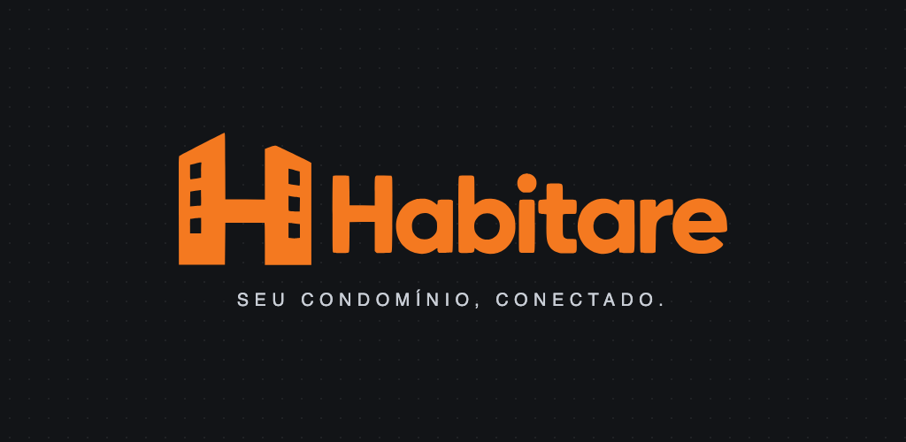
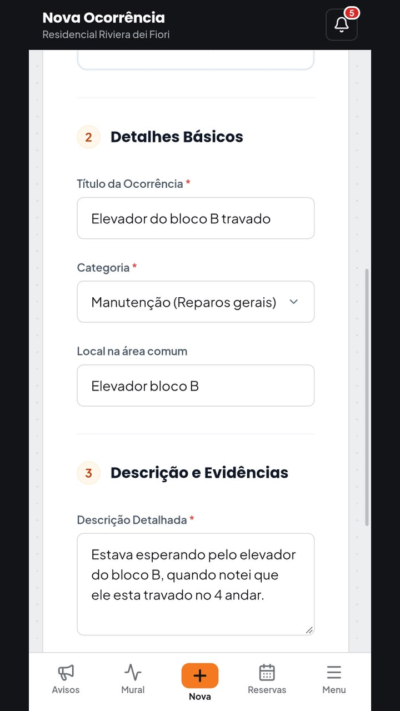
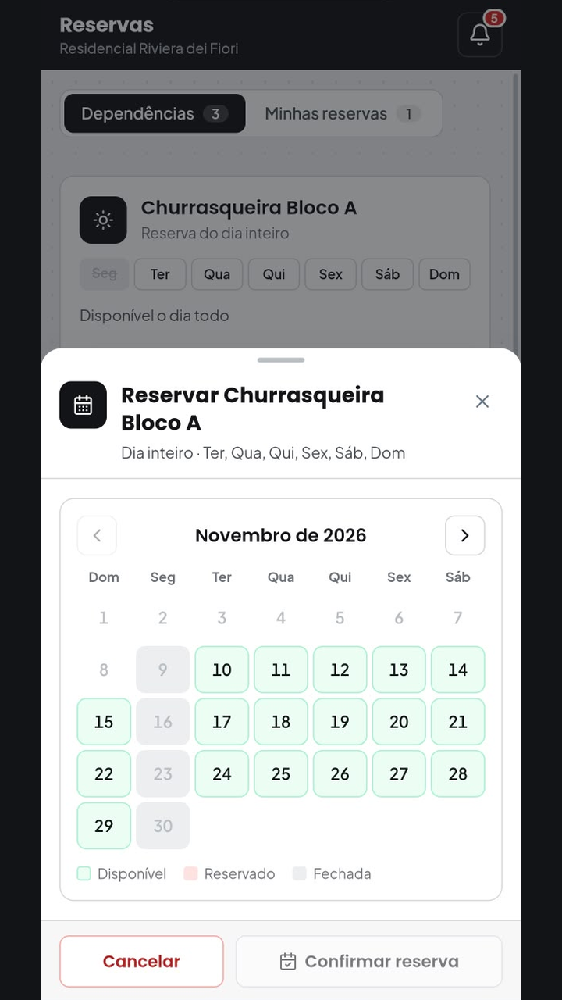
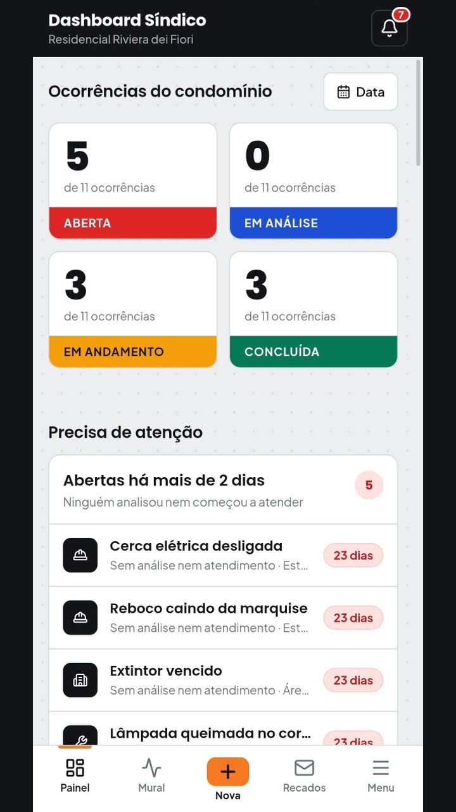
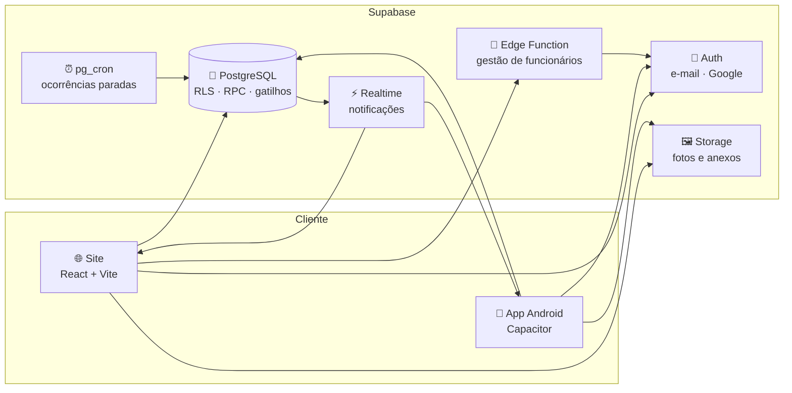

<div align="center">



<h1>Habitare · Portal do Morador</h1>

<p><strong>Gestão de condomínio na palma da mão:</strong> ocorrências com fotos e acompanhamento, reclamações direto ao síndico,<br/>
reservas de áreas comuns, avisos, recados da equipe e painéis com indicadores, na web e no Android.</p>

<p>
  
  
  
  
  
  
</p>

<p>
  
  
  
</p>

</div>

---

## 📌 Sumário

- [Sobre o projeto](#-sobre-o-projeto)
- [Telas](#-telas)
- [O que o sistema faz](#-o-que-o-sistema-faz)
- [Diferenciais](#-diferenciais)
- [Tecnologias](#-tecnologias)
- [Arquitetura](#-arquitetura)
- [Segurança e privacidade](#-segurança-e-privacidade)
- [Como rodar](#-como-rodar)
- [Estrutura do repositório](#-estrutura-do-repositório)
- [Equipe](#-equipe)

---

## 🏢 Sobre o projeto

Em muitos condomínios, a comunicação ainda depende de grupos de mensagem, cadernos na portaria e cobranças
informais. Problemas se perdem, ninguém sabe em que pé está um conserto e o síndico não tem números para
decidir. O **Habitare** organiza tudo isso num só lugar.

- O **morador** registra o problema com fotos e acompanha cada etapa.
- O **síndico** distribui o serviço, acompanha prazos e vê indicadores.
- O **funcionário** recebe as tarefas e comprova o que fez.
- A **administração (Master)** cuida de moradores, equipe, blocos e áreas comuns.

O sistema foi pensado **para o celular primeiro** (*mobile-first*) e funciona igualmente bem no computador.
O mesmo código gera o site e o **aplicativo Android**, publicado na Google Play em teste fechado.

> Projeto Integrador do curso de Ciência da Computação do **CEUB** (Centro Universitário de Brasília).

---

## 📱 Telas

<div align="center">
  
  &nbsp;
  
  &nbsp;
  
  &nbsp;
  
  <p><sub>Login com e-mail ou Google · Nova ocorrência · Reserva de área comum · Painel do síndico</sub></p>
</div>

---

## ✨ O que o sistema faz

### 👤 Morador
- **Ocorrências** com local, categoria, descrição e anexos. No celular, a foto pode ser **tirada na hora** pela câmera.
- **Mural de ocorrências** do condomínio, com status (*Aberta → Em análise → Em andamento → Concluída*), andamento da equipe e pronunciamento do síndico.
- **Reclamações** sobre outra unidade, enviadas **só ao síndico**, com resposta direta para quem reclamou.
- **Reservas de áreas comuns** num calendário de até 60 dias, com horários livres e ocupados e cancelamento das próprias reservas.
- **Mural de avisos e eventos**, com imagens e prazo de exibição.
- **Minhas Solicitações**: histórico de tudo o que registrou, com busca e filtros.

### 🧑‍💼 Síndico
- **Dashboard** com indicadores, evolução semanal, mapa de calor por horário e **rankings de funcionários**.
- Quadro **"Precisa de atenção"**: ocorrências abertas ou paradas há **mais de 2 dias**, com aviso automático.
- **Análise e atribuição** de ocorrências aos funcionários, conforme a especialidade de cada um.
- **Reclamações** com abas *Abertas* e *Respondidas*.
- **Recados** para a equipe, com respostas e controle de leitura.

### 🛠️ Funcionário
- Lista das **tarefas atribuídas** e das ocorrências da sua especialidade.
- Atualização de andamento e **conclusão com foto e descrição** do serviço.
- Pedido de análise ao síndico quando precisa de uma decisão.

### 🏛️ Master (administração)
- Cadastro do condomínio com **blocos, andares e apartamentos** e **áreas comuns** (dia inteiro ou por horário).
- **Aprovação de moradores** e nomeação do síndico.
- **Gestão de funcionários**, cadastrados só com a conta Google, sem senha provisória.
- Visão geral consolidada do condomínio.

### 🧩 Equipe Habitare
- Aprovação de **novos condomínios** que pedem para entrar na plataforma.
- Atendimento dos **pedidos de exclusão de conta** (LGPD / Google Play).

---

## 🚀 Diferenciais

| | |
|---|---|
| 🔔 **Notificações em tempo real** | Cada mudança importante avisa quem precisa saber e abre direto o item relacionado. Contadores (bolinhas) mostram o que está pendente. |
| ⏱️ **Nada fica esquecido** | Tarefas agendadas no banco (*pg_cron*) detectam ocorrências paradas há mais de 2 dias e avisam o síndico automaticamente. |
| 🔑 **Login com Google** | No site e no app (pelo navegador do celular). Moradores novos completam o cadastro com o e-mail já preenchido. |
| 📲 **Um código, duas plataformas** | O site em React vira app Android com o Capacitor, com câmera, botão voltar, barra de status e barra inferior própria de cada perfil. |
| 🛡️ **Moderação** | Comentários e recados passam por um filtro de palavras ofensivas no próprio banco. |
| 🔎 **Busca amigável** | Procura ignorando acentos e maiúsculas, por título, categoria ou código da ocorrência. |
| 🗑️ **Privacidade de verdade** | O usuário pede a exclusão da conta no próprio app, e a equipe conclui o pedido apagando os dados pessoais. |

---

## 🧰 Tecnologias

<div align="center">


</div>

| Camada | Tecnologia | Uso no Habitare |
|---|---|---|
| **Interface** |   | Telas, rotas protegidas por perfil e navegação |
| **Build** |  | Servidor de desenvolvimento e build de produção |
| **Estilo** |   | Identidade visual própria, responsiva e *mobile-first* |
| **Gráficos e ícones** |   | Dashboard do síndico e ícones da interface |
| **Backend** |  | Autenticação (e-mail e Google), Storage de fotos, Realtime e Edge Functions |
| **Banco de dados** |  | Regras de acesso (RLS), funções (RPC), gatilhos e *pg_cron* |
| **Mobile** |    | App Android gerado a partir do mesmo código do site |
| **Distribuição** |  | Teste interno e teste fechado |
| **Qualidade** |  | Padronização e verificação do código |

---

## 🏗️ Arquitetura



- **Regras no banco:** cada tabela tem *Row Level Security*, e cada perfil enxerga só o que pode. As ações sensíveis (aprovar, atribuir, reservar, excluir conta) são funções no PostgreSQL, que validam o perfil antes de agir.
- **Sem servidor próprio:** o frontend fala direto com o Supabase. A única lógica fora do banco é a Edge Function que cria funcionários, porque ela usa a chave administrativa, que nunca vai para o navegador.
- **Histórico completo:** cada mudança de status de uma ocorrência fica registrada, com autor e data.

---

## 🔒 Segurança e privacidade

- Autenticação pelo Supabase Auth, com e-mail e senha ou conta Google.
- Acesso controlado por **RLS** e por funções que conferem o perfil (Morador, Síndico, Funcionário, Master e Equipe).
- Reclamações visíveis **somente para o síndico**.
- Fotos e anexos no Supabase Storage, com acesso controlado por perfil (evidências e avisos em *buckets* privados, abertos por links temporários).
- **Exclusão de conta** pelo próprio usuário, conforme a LGPD e as regras da Google Play.
- [Política de Privacidade](Projeto/PRIVACIDADE.md).

---

## ▶️ Como rodar

**Pré-requisitos:** [Node.js](https://nodejs.org) 20+ e um projeto no [Supabase](https://supabase.com).

```bash
git clone https://github.com/Rafaelfgh/Projeto-Integrador-III.git
cd Projeto-Integrador-III/Projeto/frontend
npm install
cp .env.example .env.local   # preencha VITE_SUPABASE_URL e VITE_SUPABASE_ANON_KEY
npm run dev                  # abre em http://localhost:5173
```

As migrações do banco ficam em `Projeto/supabase/migrations/` e a Edge Function em `Projeto/supabase/functions/`.

**App Android:** o passo a passo de build, assinatura e publicação está em [`Projeto/frontend/ANDROID.md`](Projeto/frontend/ANDROID.md).

```bash
npm run android:sync          # gera o site e copia para o projeto Android
cd android && ./gradlew assembleDebug
```

---

## 📂 Estrutura do repositório

```
Projeto/
├── frontend/              # Site (React + Vite) e app Android (Capacitor)
│   ├── src/
│   │   ├── pages/         # Telas por perfil (painéis, mural, reservas, perfil...)
│   │   ├── components/    # Barra lateral/inferior, janelas, notificações...
│   │   ├── hooks/         # Contadores, notificações em tempo real
│   │   ├── contexts/      # Sessão e perfil do usuário
│   │   └── services/      # Integração com o app nativo (login Google, voltar)
│   ├── android/           # Projeto Android gerado pelo Capacitor
│   ├── ANDROID.md         # Guia do app Android
│   └── PLAY-CONSOLE.md    # Respostas e checklist da Google Play
├── supabase/
│   ├── migrations/        # Esquema, RLS, funções e gatilhos do banco
│   └── functions/         # Edge Function de gestão de funcionários
├── docs/readme/           # Imagens deste README
└── PRIVACIDADE.md         # Política de privacidade
```

---

## 👥 Equipe

**Desenvolvimento:** Davi Moreira · Henrique Firmino · Rafael Fonseca · Sarah Costa

**Orientação:** Prof. Fabiano Mariath D'Oliveira

<div align="center">
  <br/>
  
  <p><sub>Habitare · Seu condomínio, conectado. · Projeto Integrador · CEUB · 2026</sub></p>
</div>
